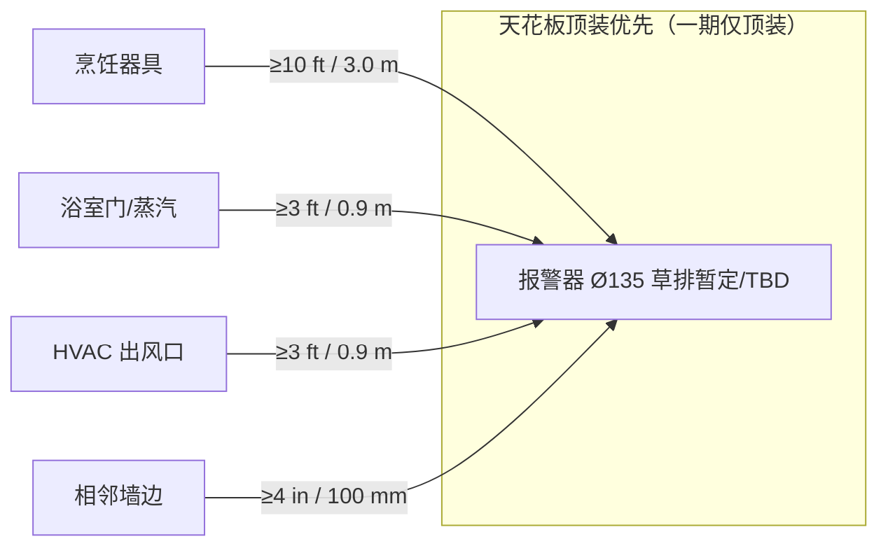

# 说明书 N-06 · 安装最小距离（定稿草案）v0.1.1

| 项 | 内容 |
|----|------|
| **文档类型** | **产品说明书草案**（送检 / 用户手册安装章素材） |
| **版本** | v0.1.1 |
| **日期** | 2026-10-22 Asia/Shanghai |
| **对应** | Issue #11 · 认证主稿缺口原 #10 · 测项 TC-N-06 |
| **权威路径** | `01_市场产品/说明书_N-06_安装最小距离_v0.1.md` |
| **关联 PRD** | `PRD-v0.1_正式版.md` §6.3 / 附录 A |
| **结构互检** | 结构 · **有条件签** · 2026-10-22 Asia/Shanghai（条件 1–3 已吸收于本版；待 Issue `#5` 绝对坐标草排 v0.1 冻结对齐后，结构再签「可作送检受控」） |

> **重要声明**  
> 1. 本文为**产品说明书草案**，**非法律意见**。  
> 2. **终值以指定实验室书面意见 + 销售地当地规范为准**；不得将本稿数字当作已 Listing / 已符合证明。  
> 3. 须与**结构安装面 / 底座 / 螺柱 / 天线窗**互检签字后方可升「送检用受控稿」。  
> 4. 下文引用 **NFPA 72**、**EN 50292**、**UL 217 / UL 2034**、**EN 14604 / EN 50291-1** 时，仅为**说明书表述参照**，**不替代**型式试验与 NRTL/NB 报告。

### 变更记录

| 版本 | 日期 | 说明 |
|------|------|------|
| v0.1 | 2026-10-22 | 初稿草案 |
| **v0.1.1** | 2026-10-22 | 吸收结构有条件签三条：Ø135/螺柱 R=48×3 标草排暂定 TBD（待 `#5`）；墙装改为一期仅顶装；§2.4 补 360° 无遮挡。**有条件签条件已吸收**；待绝对坐标对齐后结构再签「可作送检受控」 |

---

## 1. 产品假设（安装相关）

| 假设 | 说明 |
|------|------|
| 形态 | **本 SKU 一期仅顶装（扭装）**；**墙装 = 不适用 / 二期**（一期**不做墙装支架**） |
| 外形草排 | 外壳约 **Ø135 mm**（**草排暂定 / TBD**）；安装螺柱 **3× 均布，R=48 mm**（**草排暂定 / TBD**）。须等 Issue **`#5` 绝对坐标草排 v0.1** 冻结后回写一致，再消 TBD；**不得当作终值** |
| 电源 | **电池可换**（CR123A×2）；**非 AC 硬线主轨** |
| 互联 | **同品牌无线级联**；**无有线互连端子** → 安装说明不出现「红线互联」步骤 |
| Combo | SKU-EX 为 Smoke+CO；SKU-CN 一期默认无 CO → CN 说明书可省略 CO 段或标「本型号不适用」 |

---

## 2. 最小距离表（英制 + 公制）

> 表内为**说明书建议最小距离（草案）**。与当地规范冲突时，**取更严者**。标 **TBD** 者须实验室或结构回填。

### 2.1 烟雾报警（Smoke）— 全 SKU

| 安装项 | 最小距离（英制） | 最小距离（公制） | 备注 / 参照指引 |
|--------|------------------|------------------|-----------------|
| **优先安装面** | 天花板（水平面）优先 | 同左 | NFPA 72 安装实践常见表述；**本 SKU 一期仅顶装（扭装）** |
| **墙装** | **不适用（一期）** | **不适用（一期）** | **本 SKU 一期仅顶装**；墙装 = 二期；一期不做墙装支架 |
| **顶装：距相邻墙边 / 墙角水平** | **≥ 4 in** | **≥ 100 mm** | 避开墙角「死角」滞烟区 |
| **距烹饪器具水平**（炉灶/烤箱开口边缘） | **≥ 10 ft**（建议） | **≥ 3.0 m**（建议） | 滋扰抑制；过近易误报。若空间不足：**TBD** 写「尽可能远」+ 当地规范 |
| **距浴室门 / 淋浴蒸汽源水平** | **≥ 3 ft** | **≥ 0.9 m** | 防蒸汽滋扰 |
| **距 HVAC / 空调出风口水平** | **≥ 3 ft** | **≥ 0.9 m** | 防气流扰动 |
| **尖顶 / 斜顶** | 安装在距最高点水平 **≤ 3 ft** 范围内（或按当地规范） | **≤ 0.9 m** | 高峰滞烟；以当地规范为准 |
| **禁装（烟）** | — | — | 封闭柜内、极度潮湿无通风区、温度超出产品标称处（标称 **TBD** 硬件） |

### 2.2 一氧化碳（CO）— Combo / SKU-EX

| 安装项 | 最小距离（英制） | 最小距离（公制） | 备注 / 参照指引 |
|--------|------------------|------------------|-----------------|
| **顶装** | 可按烟感同点位（Combo 一体机） | 同左 | 一体机跟随烟感点位，并满足本表 CO 禁装 |
| **墙装高度带** | **不适用（一期）** | **不适用（一期）** | **本 SKU 一期仅顶装**；墙装/分体墙装高度带属二期，本稿不写安装步骤 |
| **距燃料燃烧器具水平**（炉、热水器、壁炉等） | **≥ 5–10 ft**（建议带；终值 **TBD**） | **≥ 1.5–3.0 m** | 过近可能延迟/误示；过远可能覆盖不足——实验室/规范裁定 |
| **禁装位置（CO）** | — | — | **封闭柜/抽屉内**；过高死角且无空气交换处；烟道直接出口处；户外；腐蚀性气体环境 |
| **车库 / 附建车库** | 按当地规范；常要求专用规则 | 同左 | **TBD** 是否在本产品宣称范围 |

### 2.3 多机覆盖与无线级联

| 项 | 锁定表述 |
|----|----------|
| 无线级联 | **同品牌无线级联不替代**规范要求的安装间距与房间覆盖 |
| 建议房间覆盖间距上限 | 常见实践约 **30 ft / 9 m** 量级，或按 **Listing / 当地规范 / NFPA 72 覆盖规则** — 本稿标为 **「按 Listing / 当地规范」**；数值 **TBD** 送检前与实验室确认是否写入固定数字 |
| Matter | 仅手机/生态**状态通知**；**不得**写成「可少装一台」 |

### 2.4 安装面 · 产品侧结构约束

| 项 | 要求 | 来源 |
|----|------|------|
| 底座 / 螺柱与障碍物净空 | 安装面平坦；螺柱三角（R=48×3，**草排暂定 / TBD**，待 `#5` 绝对坐标草排 v0.1 冻结后回写）完整贴合；周边无线缆压迫蜂鸣口 | 结构草排 |
| **天线窗侧净空** | **≥ 5 mm**（无金属遮挡 / 产品结构约束） | 硬件·结构绝对坐标 |
| **声腔 / 烟腔 360° 无遮挡** | **安装面须保证声腔出声口与烟腔进气格栅 360° 无遮挡（含装饰盖板）** | 结构有条件签 · 2026-10-22 |
| 电池仓 | 安装后仍可开盖换电；勿堵 `COVER_DET` 行程 | 工程 |
| 有线互连孔 | **无** — 说明书不引导打孔穿红线 | 范围锁 v0.1.1 |

---

## 3. 示意（顶视图）

### 3.1 ASCII · 厨房 / 墙边

```
                    ┌──────── 墙 ────────┐
                    │                    │
                    │    ≥4 in / 100 mm  │
                    │         ┌──┐       │
                    │         │烟│ ← 顶装薄盘（示意中心）
                    │         └──┘       │
                    │                    │
                    └────────────────────┘

     烹饪器具（炉灶）
     ┌──────────────┐
     │   COOKTOP    │············ ≥10 ft / 3.0 m ··········→  (报警器水平投影)
     └──────────────┘

     HVAC 出风口 ●···· ≥3 ft / 0.9 m ····→ 报警器
     浴室门      ▯···· ≥3 ft / 0.9 m ····→ 报警器
```

### 3.2 Mermaid · 水平距离关系



### 3.3 螺柱 / 天线窗（产品侧，供结构互检）

```
        俯视（草排暂定 / TBD — 待 #5 绝对坐标草排 v0.1）
              天线窗侧 ≥5 mm 净空
                    ↑
              · 螺柱@R48（暂定）
           ·             ·
              中心 ·
           ·             ·
              · 螺柱
         BTN_TEST_MUTE（可达）
         声腔出声口 / 烟腔进气格栅：360° 无遮挡（含装饰盖板）
```

---

## 4. 说明书建议表述（中英提纲，非终稿文案）

**中文提纲**

- 请优先安装在天花板中央附近，避开墙角。本型号一期仅支持天花板顶装（扭装），不提供墙装。  
- 请与炉灶等烹饪器具保持至少约 3 米（10 英尺）水平距离。  
- 请勿安装在浴室蒸汽直吹处或空调出风口正对处。  
- 安装时须保证蜂鸣出声口与进烟格栅四周无遮挡（含装饰盖板）。  
- 本产品支持同品牌无线级联报警，**不能替代**按规范在每个所需房间安装报警器。  
- 一氧化碳报警（若本型号具备）不可用用户静音关闭危急声光；安装勿置于封闭柜内。  

**English outline**

- Install on the ceiling where possible; keep clear of corners. This SKU supports ceiling twist-mount only in phase 1 (no wall mount).  
- Keep at least about 10 ft (3.0 m) horizontal clearance from cooking appliances.  
- Do not install where shower steam or HVAC supply air blows directly on the alarm.  
- Keep the sounder outlet and smoke inlet grille clear 360° (including decorative covers).  
- Same-brand wireless interconnect does **not** replace code-required placement.  
- If your model includes CO: do not install inside cabinets or dead air spaces.

Listing / 包装：**不点名 Nest**；不写未验证「保证无误报」。

---

## 5. 引用指引（说明书参照，非替代型式试验）

| 指引 / 标准 | 在说明书中的用法 |
|-------------|------------------|
| **NFPA 72** | 美线安装位置、覆盖与互连**实践参照**；产品认证仍靠 **UL 217 / UL 2034** |
| **EN 50292** | 欧线 CO **选型与安装指引**参照；产品性能试验仍靠 **EN 50291-1** |
| **UL 217 / UL 2034** | 产品安全/性能 Listing 路径；本稿距离 ≠ 已通过证明 |
| **EN 14604 / EN 50291-1** | 欧线烟 / CO 型式主标准；本稿距离 ≠ DoP/CE 证明 |

---

## 6. 检查清单

| # | 动作 | 主责 | 状态 |
|---|------|------|------|
| 1 | 结构确认安装面、墙装是否提供、螺柱三角与净空 | 结构 | ☑ 有条件签（2026-10-22）；待 `#5` 对齐后签「可作送检受控」 |
| 2 | 增长写入用户说明书 / 快速指南安装章 | 增长 | ☐ |
| 3 | 测试挂 **N-06 / TC-N-06**（有最小距离说明） | 测试 | ☐ |
| 4 | 认证主稿缺口 **#10** 可改为「草案已出，待结构签」 | 市场产品 | ☑ 本稿同步时改 |
| 5 | 实验室书面确认是否固化「30 ft / 9 m」等覆盖句 | 市场产品+测试 | ☐ TBD |
| 6 | Combo 与 SKU-CN（无 CO）说明书分册/条件段 | 市场产品 | ☐ |
| 7 | `#5` 绝对坐标草排 v0.1 冻结后回写 Ø135 / R=48×3 并消 TBD | 结构+市场产品 | ☐ |

---

## 7. 与结构互检待签

| 互检项 | 结构确认 | 市场产品确认 | 日期 | 签字 |
|--------|----------|--------------|------|------|
| **本 SKU 一期仅顶装（扭装）**；墙装不适用/二期；不做墙装支架 | ☑ 有条件签 | ☑ v0.1.1 已写死 | 2026-10-22 | 结构·有条件 |
| Ø135 / 螺柱 R=48×3 与说明书图一致 | ☐ **草排暂定 / TBD** — 待 `#5` 绝对坐标草排 v0.1 冻结后回写一致再消 TBD | ☑ 已标 TBD | 2026-10-22 | — |
| 天线窗侧 ≥5 mm 写入安装注意 | ☑ | ☑ | 2026-10-22 | 结构·有条件 |
| 无有线互连开孔（说明书无红线步骤） | ☑ | ☑ | 2026-10-22 | 结构·有条件 |
| 蜂鸣口 / 进烟口不被底座遮挡；**360° 无遮挡（含装饰盖板）** | ☑ | ☑ §2.4 已补 | 2026-10-22 | 结构·有条件 |
| N-06 表内距离可进送检说明书 | ☐ 待「可作送检受控」签（条件=改点已吸收 + `#5` 对齐） | ☑ 有条件签条件已吸收于 v0.1.1 | 2026-10-22 | — |

**签署栏**

- 结构：**有条件签**（条件 1–3 见结构回函；本稿 v0.1.1 已吸收）　日期：2026-10-22 Asia/Shanghai  
  - 条件消清后请再签「**可作送检受控**」  
- 市场产品：__________　日期：__________  
- 测试（挂项确认）：__________　日期：__________  

---

**— 市场产品 · N-06 v0.1.1 · 2026-10-22 Asia/Shanghai —**  
**非法律意见 · 终值以实验室 + 当地规范为准 · 结构有条件签条件已吸收 · 待 `#5` 对齐后结构再签「可作送检受控」**

---

## 7. 说明书 CLAIM 红线（与安装章同册时必带）

写入用户说明书「功能/安全」章时必须分列，且与 Listing v0.2.2 一致：

1. **无线级联**：同品牌无线整屋跟报（可断云）；**不是**有线 AC 多站互联，**不宣称**已获有线 multiple-station Listing。  
2. **Matter**：仅 App/生态状态与通知；**不能替代**本地级联，**不是**消防互联。  
3. **Hush**：**仅烟雾**可临时静音（约 9 分钟自动恢复）；**一氧化碳报警禁止用户静音**。  
4. **禁 Nest 剧本**：不使用 Heads-Up /「烟雾在×房间」类房间名播报文案；说明书不点名 Nest。
