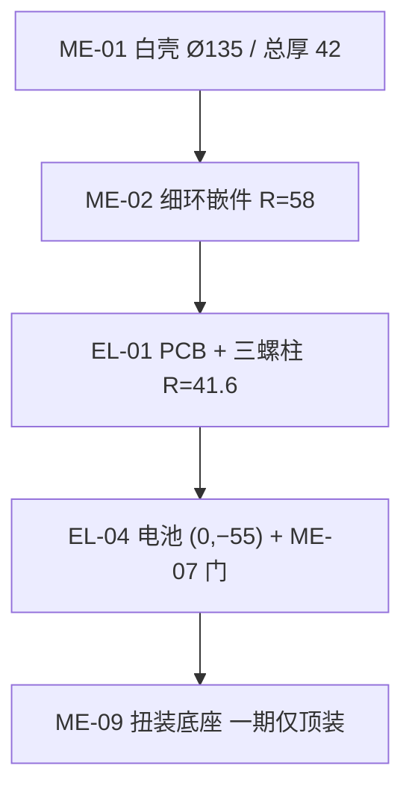

# 超级烟感 · 结构 · G3 装配图与关键公差 v0.1

**日期**：2026-10-22 Asia/Shanghai  
**Issue**：[#5](https://github.com/Leo2442926161/test1/issues/5)  
**性质**：G3 总装说明，供 EVT 打样对图。**不是** CAD / STEP，**不能**开模。未注线性尺寸 **±0.5 mm**，未注角度 **±1°**。  
**叠板**：硬件 **2026-10-22 通过**。螺柱 R=41.6 三点、天线窗、灯环、按键、电池的平面坐标无冲突。本文件不改这些数。  
**坐标系**：板心 = 壳体圆心；mm；正视外观面 **+X 右、+Y 上**；PCB 顶面 **Z=0**；**+Z 朝房间**（天花安装时朝下）。  
**配套**：`超级烟感_结构_绝对坐标草排_v0.1.md`、`超级烟感_结构_灯环ch0-63地址表_v0.1.md`、`超级烟感_结构_G3开孔与遮光井_v0.1.md`、`../DFM/超级烟感_结构_G3_DFM-DFA_v0.1.md`。

不下单。不宣称已过 UL 217 / UL 2034 / EN 14604 / EN 50291。

---

## 1. 锁定尺寸（对图时不得改标注）

| 项 | 值 |
|---|---|
| 总厚 | **42**（外表面 Z=+26 到 底座外表面 Z=−16） |
| 外径 | **Ø135** |
| 螺柱 | **(41.6, 0)**、**(−20.8, 36)**、**(−20.8, −36)**；M2；支撑面 Z=−1。半径 **41.6**，**勿写 R=48** |
| 灯环 | 光学中心 **R=58**；ch0=(58, 0)；正视逆时针；步进 5.625° |
| 天线窗 | 中心 **(0, +52)**；开口 18×12；馈点 (0, +48) 上方净空 **≥5** |
| 电池对 | 中心 **(0, −55)**；左右芯 (−18, −55) / (+18, −55) |
| `BTN_TEST_MUTE` | 对齐点 **(0, −58)**；键帽 (0, −66) |
| 安装 | **一期仅顶装**（扭装）。无墙装支架。无有线互连孔 |
| 光学 | Listing 只装 **TI 分立**。ADPD 同腔预留，B-TI 空贴 |

电子栈目标 27、硬限 ≤28（PCB 底 Z=−1 到件顶/灯环叠高）。概念页挑战总厚 ≤40 **本堆叠未达到**。

---

## 2. 爆炸顺序（房间侧在上）

```
        [ME-01 白壳]          Z 外表面 +26
        [ME-02 细环遮光嵌件]   R=58 出光缝
        [ME-04 中心导光柱]     (0,0)
        [ME-03 PATH 导光]      弦 Y=−62
        [EL-02 柔灯环]         缺口朝 +X = ch0
        [ME-05 烟迷宫]         TI 腔；ADPD 空贴
        [EL-01 PCB]            Z=0，Ø112 可用
        [ME-10 螺钉×3]         只进三颗螺柱
        [EL-03 压电]           (0,−40) 深 9
        [ME-08 键帽+推杆]      帽 (0,−66)，对齐 (0,−58)
        [ME-07 电池门]         侧壁 −Y；COVER_DET (−40,−20)
        [EL-04 CR123A×2]
        [ME-09 扭装底座]       外表面 Z=−16；仅顶装
```



---

## 3. 零件清单（EVT 对图用，非正式 BOM）

| 件号 | 名称 | 数量 | 对图要点 |
|---|---|---:|---|
| ME-01 | 外观白壳 | 1 | Ø135；外表面 Z=+26；主视白盘，不是发光环面 |
| ME-02 | 细环导光 + 段间遮光井 | 1 | 64 缝；基准缺口朝 +X |
| ME-03 | 底边 PATH 导光 | 1 | 另腔，弦 Y=−62，PATH0–5，不占 ch |
| ME-04 | 中心状态导光柱 | 1 | 出光 Ø2.4 @ (0,0)；不进灯串 |
| ME-05 | 烟迷宫 / 光学腔盖 | 1 | 包络 X −32..−2，Y +2..+32。量产只装 TI |
| ME-06 | 声腔盖 + 垫圈 | 1 | 中心 (0,−40)，深 **9**（8–10）；与烟腔、灯井不通 |
| ME-07 | 电池门 | 1 | 侧壁 −Y。打开不抬触点 |
| ME-08 | 键帽 + 水平推杆 | 1 | 帽 Ø8 @ (0,−66)；行程 0.6。推杆只在 Z 0..+4 |
| ME-09 | 扭装底座 | 1 | 顺时针锁到天花。**无墙装支架，无穿线孔** |
| ME-10 | PCB 螺钉 M2 | 3 | 只允许进三颗锁定螺柱 |
| EL-01 | 主 PCB | 1 | B-TI：TI 分立实贴，ADPD DNP |
| EL-02 | 柔灯环 64 | 1 | 接插件 (+35, 0)；铜皮绕开天线窗 |
| EL-03 | 压电 | 1 | 铁壳不进天线净空柱 |
| EL-04 | CR123A | 2 | 轴向 // X，典型包络 Ø17×34.5 |

---

## 4. 关键装配公差（EVT 卡尺 / 对图）

对图原点用壳体外圆中心，+X 用柔板缺口 / ch0 出光缝。下表是打样接收，不是模具 GD&T。

| ID | 项目 | 名义 | EVT 接收 |
|---|---|---|---|
| A1 | 外径 | Ø135 | ±0.5 |
| A2 | 总厚 | 42 | ±0.5，且 **≤45** |
| A3 | 电子栈 | 27 | ≤28 |
| A4 | 螺柱 1 | (41.6, 0) | XY ±0.5；支撑面 Z=−1 ±0.5 |
| A5 | 螺柱 2 | (−20.8, 36.0) | 同上 |
| A6 | 螺柱 3 | (−20.8, −36.0) | 同上 |
| A7 | 灯环同心 | R=58 相对原点 | 半径 ±0.5；圆心偏移 ≤0.5 |
| A8 | ch0 方位 | +X，α=0° | ±1°。缺口只能朝 +X |
| A9 | 天线窗中心 | (0, +52) | ±0.5；开口 18×12 ±0.5 |
| A10 | 天线净空 | 馈点上方 | **≥5.0**，只许更大。柱内无金属 |
| A11 | 电池对中心 | (0, −55) | ±0.5 |
| A12 | BTN 对齐点 | (0, −58) | ±0.5 |
| A13 | 键行程 | 0.6 | 须落在 0.4–0.8，有段落 |
| A14 | COVER_DET | (−40, −20) | 门移约 1 mm 即切换，且早于电芯可抽出 |
| A15 | 声腔深 | 9.0 | 8–10 |
| A16 | 扭装止挡 | 顺时针到位 | 到位后径向晃动量 ≤0.5；逆时针可拆 |

面差 ≤0.15、底座可见缝 ≤0.3 是概念页的**后续模具目标**。EVT 打样不按这两条拒收。

---

## 5. 扭装底座（一期仅顶装）

| 项 | 要求 |
|---|---|
| 方向 | 底座先上天花，机身**顺时针**拧入至止挡；逆时针拆 |
| 范围 | **只做顶装**。零件清单里没有墙装支架，说明书不得画墙装步骤 |
| 止挡 | 到位有硬止挡，防止过拧把出声缝拧到贴天花 |
| 螺柱 | 机身三颗螺柱是 **PCB 固定**，不是天花螺钉。天花孔距仍待实测，**本图不编中心距** |
| 互连 | 底座和机身都**没有**穿线孔、敲落孔、总线端子窗 |

ASCII（从房间向上看，即朝 −Z 看安装面时，左右与正视相反；对图请用正视外观面的坐标，不要用这张图量 X 正负）：

```
天花
  └── ME-09 底座（先上墙）
        └── 顺时针拧入 ME-01
              PCB 用三颗 M2 固定在 R=41.6
              房间侧 = +Z = 白壳
```

---

## 6. 电池仓与 `COVER_DET`

| 项 | 尺寸 / 动作 |
|---|---|
| 对中心 | (0, −55)，侧壁，远离 +Y 天线 |
| 左 / 右芯 | (−18, −55) / (+18, −55)，轴 // X |
| 包络 | 每芯 Ø17 × 34.5；两芯端面间隙 1.5 |
| 高度 | 电芯占 Z +6..+23，在声腔（Z≤+2）之上 |
| 门 | ME-07。免工具推扣。极性筋：反插不能到底 |
| 触点 | 门打开**不**抬起弹簧。电芯留在仓内时板仍上电 |
| `COVER_DET` | 舌片 (−40, −20)，Z 0..+4。门离开闭合位约 1 mm，开关先变；电芯仍抽不出 |
| 天线 | 金属托若有，停在 −Y，不得进入 (0,+52) 净空柱 |

EVT 对图：门全开、电芯仍在，测 VSYS 仍在；探针读到 `COVER_DET` 已切换。

---

## 7. `BTN_TEST_MUTE`

中心是状态点，不是按键。

| 件 | 位置 | Z |
|---|---|---|
| 开关对齐点 | (0, −58) | 开关体在 0..+4 |
| 键帽 | (0, −66)，Ø8 | 裙边 +22..+26 |
| 推杆 | 从 Y=−66 水平进到 Y=−58 | **只走 Z 0..+4** |

ch48 的导光井在同一 XY，但是 Z +6..+26、径向只宽 1.4。推杆从井下面过去，不打穿细缝。行程名义 0.6，接收 0.4–0.8。装在底座上之后，房间内单手能够到键帽。

---

## 8. EVT 打样对图步骤

1. 放平，找外圆中心，核对 Ø135 与总厚 42。  
2. 用 ch0 缺口定 +X，再量三颗螺柱，必须是 (41.6, 0) / (−20.8, 36) / (−20.8, −36)，不是 R=48。  
3. 量天线窗中心 (0,+52)，用 5 mm 塞尺确认柱内无金属。  
4. 量电池对 (0,−55) 与按键对齐点 (0,−58)，确认与灯环 R=58 只有 Z 向重叠、平面坐标与叠板一致。  
5. 只点亮 ch0：亮缝在 +X。再按地址表抽 ch16、ch48。  
6. 开电池门：不断电，且 `COVER_DET` 已动作。  
7. 目视全壳：无穿线孔。光学位只有 TI，ADPD 空贴。  
8. 拧上底座：顺时针止挡，无墙装零件。

任一条用了别的坐标，打样单退回，不改网表脚。
