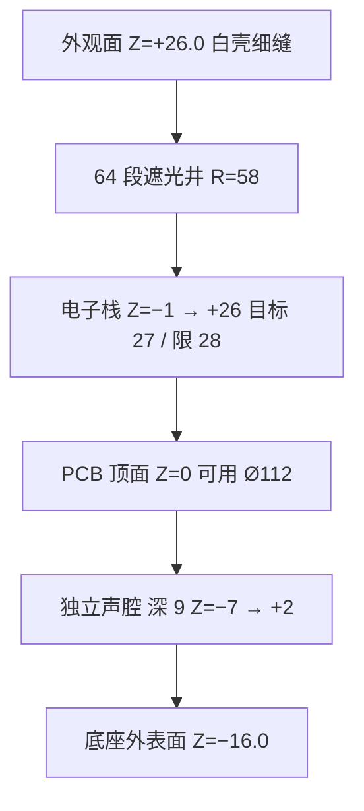

# 超级烟感 · 结构 · 绝对坐标草排 v0.1

**日期**：2026-10-22 Asia/Shanghai  
**Issue**：[#5](https://github.com/Leo2442926161/test1/issues/5)  
**性质**：EVT 前绝对坐标草排（Markdown + 示意）。**不是** CAD / STEP，**不能**直接开模。未注线性尺寸公差 **±0.5 mm**（草排级），未注角度 **±1°**。  
**平面坐标**：与硬件 [`../../硬件设计/_archive/超级烟感_绝对坐标草排_v0.1.md`](../../硬件设计/_archive/超级烟感_绝对坐标草排_v0.1.md) 同一套原点——板心 = 壳体圆心，单位 **mm**，正视外观面，**+X 右、+Y 上**。该硬件稿螺柱摘要 R=48 作废；锁定三点以本文件为准。本文件补上 **Z**。  
**Z**：主 PCB **顶面铜 = 0**；**+Z 朝用户**（天花安装时朝房间、朝下）。  
**网表**：`../../硬件设计/原理图/超级烟感_原理图网表骨架_v0.1.2.md`（`LED_RGB`×64、`LED_STATUS`、天线窗）。灯环通道号见 `超级烟感_结构_灯环ch0-63地址表_v0.1.md`。

**叠板状态**：硬件 **2026-10-22 通过**（螺柱 R=41.6 三点、天线窗、灯环、按键、电池 XY 无冲突）。锁定尺寸不改：总厚 **42**、Ø**135**、螺柱 **(41.6, 0) / (−20.8, 36) / (−20.8, −36)**、灯环 **R=58** ch0–63、天线窗 **(0, +52)** 净空 **≥5**、电池 **(0, −55)**、BTN **(0, −58)**。一期**仅顶装**。无有线互连孔。Listing 光学绑 **TI**。

**G3 出图**（仍非 CAD/STEP，可支撑 EVT 打样对图）：

- `超级烟感_结构_G3装配图与关键公差_v0.1.md`
- `超级烟感_结构_G3开孔与遮光井_v0.1.md`
- `../DFM/超级烟感_结构_G3_DFM-DFA_v0.1.md`

不下单。不宣称已过 UL/EN。

---

## 1. 已锁约束（本表必须遵守）

| 项 | 草排落实 |
|---|---|
| 白壳浅色薄盘 | 外观件白色；主视面是白盘，不是发光环面 |
| 总厚 | **42.0**（≤ **45**）。概念页挑战值 ≤40 **本版未达到**，不假装达到 |
| 电子栈 | PCB 底面到最高电子件/灯环叠高目标 **27**，硬限 **≤28** |
| 外形 | 细环 + 中心状态点 + 底边线型路径光。**禁止** Nest 大环面 |
| 灯 | **64** 段可寻址 RGB；段间遮光井；底边导光 **另腔**，不占 ch0–63 |
| 天线 | 馈点上方净空 **≥5**，非金属窗；螺柱/电池/蜂鸣铁壳不进该柱 |
| 电池 | CR123A×2，可换，**侧置**，远离天线；`COVER_DET` 必有 |
| 声腔 | 独立，深 **9.0**（落在 **8–10**） |
| 光学 | 同一烟腔。Listing 只装 **TI 分立**；**ADPD 只留 EVT 腔体**，量产位 DNP |
| Hush | 实体键 `BTN_TEST_MUTE`。无有线互连开孔。无线级联 **不改壳** |
| 外径 | 采用硬件假设 **Ø135**（概念页 120–140 量级之内，ID 还可收轮廓，但下列基准点先不动） |
| 安装 | **一期仅顶装**（扭装）。不做墙装支架。无有线互连孔 |

---

## 2. 正视（朝 +Z 看外观面）

```
                         +Y
                    天线窗 (0,+52)
                    ch16 (0,+58)
           ch24                    ch8
              螺柱2 (−20.8,+36)

    ch32              LED_STATUS           ch0 (58,0)     +X
   (−58,0)               (0,0)              螺柱1 (41.6,0)

              螺柱3 (−20.8,−36)
                    蜂鸣 (0,−40)
                    电池对 (0,−55)
                    键对齐 (0,−58) = ch48 的 XY
                    底边路径弦 Y=−62
                         −Y
```



总厚 = 26.0 − (−16.0) = **42.0**。

---

## 3. 关键绝对坐标

平面值除灯环外，能与硬件草排对上的都沿用硬件表，不另起一套原点。

| 特征 | X | Y | Z | 备注 |
|---|---:|---:|---|---|
| 原点 | 0 | 0 | 0 | 板心 / 壳体圆心；Z 为 PCB 顶面 |
| `LED_STATUS` 导光柱 | 0.00 | 0.00 | 出光在 +26 | 中心状态点，Ø2.4 出光，直驱，不进 ch |
| 灯环光学中心 | R=58 | — | 灯珠约 +3，出光缝在 +26 | ch0=(58.00, 0.00)，逆时针，见地址表 |
| 天线馈点 | 0 | +48 | 铜在 0–1.8 | 硬件草排 |
| 天线窗 | 0 | +52 | 净空柱 Z=1.8→6.8 | 窗开口 18×12（X −9..+9，Y +46..+58）；柱内无金属、无铜、无螺钉、无电池簧、无蜂鸣壳、无导电漆 |
| 螺柱 1 | +41.6 | 0 | 支撑面 Z=−1 | M2；R=41.6 @ 0° |
| 螺柱 2 | −20.8 | +36.0 | 同上 | M2；约 120° |
| 螺柱 3 | −20.8 | −36.0 | 同上 | M2；约 240° |
| nRF54L15 | 0 | −8 | 主控面 | 硬件草排，结构不挪 |
| TI 光 LED | −22 | +12 | 腔底约 +2 | Listing 量产位 |
| TI 光 PD | −12 | +22 | 腔底约 +2 | 与 LED 夹角待光路，平面点先冻 |
| ADPD EVT 预留 | −18 | +16 | 同腔 | **与 TI 互斥**；B-TI 此位 DNP |
| 光学腔包络 | X −32..−2 | Y +2..+32 | Z +1..+15 | 共型烟腔；迷宫出气不进灯井 |
| TGS5141 | +28 | +10 | 腔底约 +2 | CO 气窗朝外沿，口约 (60, 22) |
| 压电中心 | 0 | −40 | 腔 Z −7..+2 | 包络 Ø12 × **深 9.0**；出声朝房间 |
| 出声缝 1 / 2 | −10 / +10 | −48 | 缝在裙边 Z +18..+22 | 8×1.5；不对进烟口，不对路径光 |
| 电池对中心 | 0 | −55 | 电芯 Z +6..+23 | 侧壁；两芯轴向沿切向（// X） |
| 电芯左 / 右 | −18 / +18 | −55 | 同上 | 典型 CR123A 包络 Ø17×34.5，端面留 1.5 |
| `COVER_DET` | −40 | −20 | 舌片 Z 0..+4 | 仓盖舌；开盖先报开关，触点仍供电直到电芯被取出 |
| `BTN_TEST_MUTE` 对齐点 | 0 | −58 | 开关在 Z 0..+4 | 与硬件草排同一点；与 ch48 **同 XY、不同 Z** |
| 键帽 | 0 | −66.0 | 裙边 Z +22..+26 | Ø8，行程 **0.6**（落在 0.4–0.8）；不盖住 ch48 细缝 |
| 底边路径弦 | X −22..+22 | **Y=−62** | 另腔，出光在裙边 | `PATH0..5`，**不是** ch |
| 灯环接插件 | +35 | 0 | PCB | 硬件草排；柔板从此出到环 |
| 外壳 | Ø135 | — | 外表面 +26 / 底座 −16 | 壁厚名义 1.8 |

`PATH` 光学中心（另腔，不进地址表）：

| ID | X | Y |
|---|---:|---:|
| PATH0 | −20 | −62 |
| PATH1 | −12 | −62 |
| PATH2 | −4 | −62 |
| PATH3 | +4 | −62 |
| PATH4 | +12 | −62 |
| PATH5 | +20 | −62 |

---

## 4. 6 点钟为什么叠在一起，以及 Z 怎么错开

硬件草排把蜂鸣 (0,−40)、电池 (0,−55)、按键 (0,−58) 和灯环 6 点（ch48）放在同一方位。本草排 **不改这些 XY**，用 Z 和出光缝宽度错开：

| 层 | Z | 谁在这里 |
|---|---|---|
| 开关与水平推杆 | 0 .. +4 | `BTN_TEST_MUTE`。推杆贴 PCB，从裙边 Y=−66 进到对齐点 Y=−58，走在电芯下面 |
| 声腔 | −7 .. +2 | 深 9。铁壳停在 Y≥−46，与电芯内沿 Y=−46.5 错层，实体肋目标 ≥1.0 |
| 电芯 | +6 .. +23 | 侧壁仓。不进入天线半平面（天线在 +Y） |
| ch48 导光 | +6 .. +26 | 只占径向 1.4 的细缝。推杆不穿此井 |
| 底边路径腔 | 另腔，弦 Y=−62 | 与细环（Y=−58）之间约 4 mm 不透光肋 |
| 键帽 | 裙边 +22..+26 | 在电芯外侧，单手可及；不是中心键 |

中心是状态点，不是 Nest 式中心大键。

天线柱 (0,+52) 与 ch16 (0,+58) 在平面上相接：ch16 的导光只允许透明塑料；柔板铜皮从 X≈±12 绕开窗口。螺柱 2 (−20.8,+36) 到窗口中心约 26 mm，不进净空柱。

---

## 5. 开孔（声 / 光 / 气）— EVT 可对

| 开孔 | 位置 | 验证 |
|---|---|---|
| 细环 64 缝 | 地址表 | 只点一 ch，邻段不亮；缝宽 1.4，看起来是细环不是环面 |
| 中心点 | (0,0) | 与环独立亮灭 |
| 底边路径 | Y=−62 弦 | 环灭时仍可单亮 PATH；与 ch48 之间有肋 |
| 出声缝 | (±10,−48) | 不朝进烟口、不朝路径光；声腔与灯井、烟腔都不连通 |
| 进烟 | 裙边约 (±63, +8) 一组 | 避开天线窗、电池门、出声缝、路径光 |
| CO 气窗 | 约 (60, 22) | 单独窗口，不进烟迷宫 |
| 天线窗 | (0,+52) | 塑料，量具确认上方 ≥5 mm 无金属 |
| 互连孔 | **无** | 壳上没有穿线孔、红线敲落孔、总线端子窗。级联不改壳 |

底座拧转卡入（顺时针锁）。接线盒孔距概念页标为待实测，**本草排不给假的螺孔中心距**。

---

## 6. 螺柱半径

硬件摘要曾写「R=48」，表内三点实为半径 **41.6**：(41.6, 0)、(−20.8, 36.0)、(−20.8, −36.0)。**2026-10-22 叠板按这三点通过**，不再使用 R=48。本文件不去改那份硬件稿。

---

## 7. 本版故意不冻

- 外壳最终轮廓、拔模后的分型线、表面纹理（ID）。
- 美欧底座槽孔的真实中心距。
- TI 光路夹角的最终射线；平面点先用硬件表。
- 模组外形以 Raytac AN54LQ-15 料册复核；本窗是净空包络，不是料册外形。
